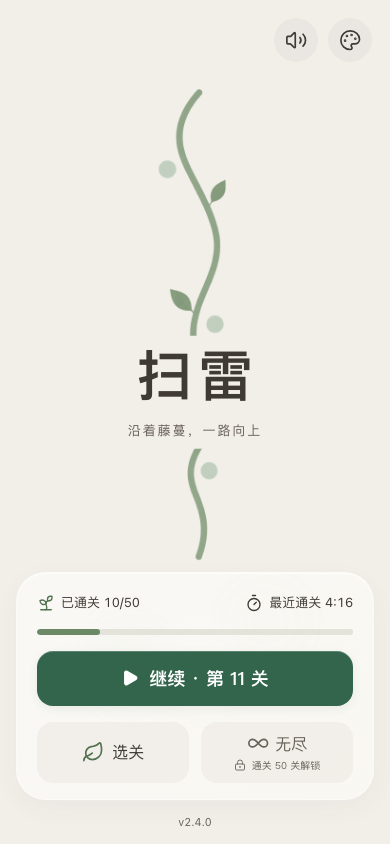
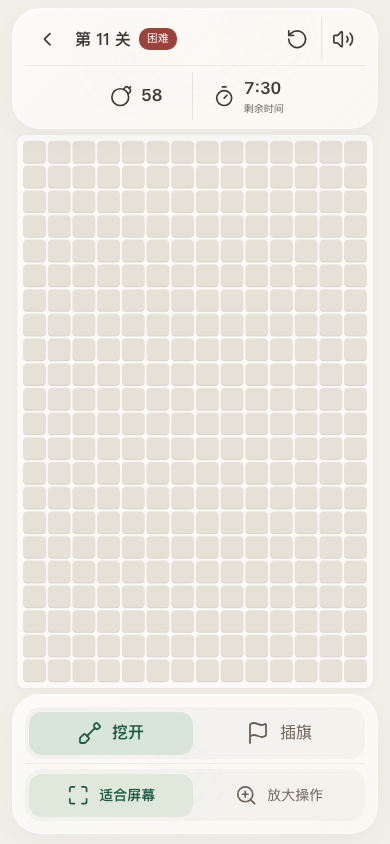

# 清透玻璃界面更新

原版基线：v2.4.0 / bb6fb728c53f5d9c94cbd1103ceefab827480249。

首页改为轻透面板、独立偏好开关和绿色主按钮。游戏顶部将导航与状态分开，底部将点按模式与显示尺寸分组。关卡、算法和存档格式保持兼容。

菜单操作使用直接点击与键盘激活，替代旧的跨按钮液滴拖动。桌面左键执行当前所选的挖开或插旗模式，右键仍可快捷插旗。显示尺寸“可操作尺寸”的可见文案缩短为“放大操作”。

新增图标来源：[Lucide](https://lucide.dev/)，ISC 许可，依赖版本由 package-lock.json 锁定。藤蔓装饰使用内置 ImageGen 根据清透玻璃设计稿生成，最终文件为 `public/art/home-vine.png`。

资产生成提示：根据设计稿左侧首页，仅生成透明背景的极简鼠尾草绿藤蔓；单根圆头弯曲茎、两片扁平叶、浅绿色圆点，上下两段之间留出真实标题的透明空间；配色 #9faf99 / #91a58a / #c9d6c7；不含 UI、文字、阴影、背景或纹理。

验证结果与对比截图见 [design-qa.md](design-qa.md)。425 项单元测试、36 项浏览器测试以及 PWA 更新测试通过。

